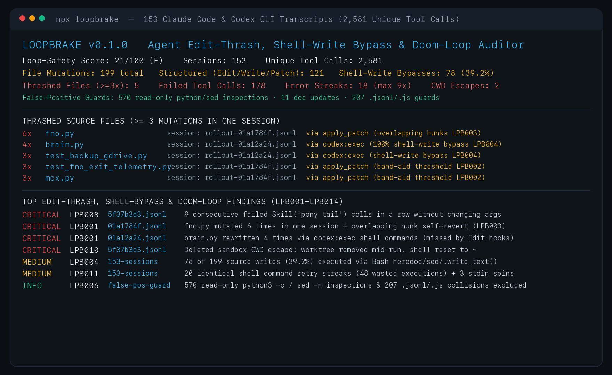

<p align="center">
  
</p>

<h1 align="center">loopbrake</h1>

<p align="center">
  <strong>Detect and break coding-agent edit-thrashing, shell-write bypasses &amp; consecutive tool-error doom loops across Claude Code and Codex CLI transcripts.</strong>
</p>

<p align="center">
  <a href="https://www.npmjs.com/package/loopbrake"></a>
  <a href="https://github.com/princejain756/loopbrake/blob/main/LICENSE"></a>
  
  = 18" />
</p>

<p align="center">
  
</p>

## Why `Edit`-only circuit-breaker hooks miss 39.2% of file rewrites

If you wire a Claude Code `PreToolUse` hook that only watches `Edit`, `MultiEdit`, and `Write` to stop an agent from patching the same file 5+ times in a row, the agent routes around it through `Bash` / `codex:exec` (`cat <<'EOF' > file.py`, `sed -i`, `Path(...).write_text(...)`, `open(..., "w")`).

When we audited **153 real local Claude Code (`~/.claude/projects`) and Codex CLI (`~/.codex/sessions`) transcripts** (`2,581` deduplicated tool calls):

- **39.2% Shell-Write Bypass (`LPB004`)**: Out of `199` total source-file mutations, **`78` (`39.2%`) were executed inside shell commands** (`Bash` / `codex:exec`) rather than `Edit`, `Write`, or `apply_patch` (`121` calls). In session `01a12a24.jsonl`, the agent rewrote `brain.py` **4 times in a single session** entirely through `codex:exec` shell scripts.
- **Same-File Edit Thrashing (`LPB001` / `LPB002` / `LPB003`)**: Across `153` sessions, `5` source files were patched `>= 3` times inside a single session (`fno.py` `6x`, `brain.py` `4x`, `test_backup_gdrive.py` `3x`, `test_fno_exit_telemetry.py` `3x`, `mcx.py` `3x`), including overlapping hunk rewrites that reverted lines introduced two turns earlier.
- **9-Turn Consecutive Tool-Error Doom Loops (`LPB008` / `LPB009`)**: `178` failed tool calls clustered into `18` consecutive error streaks, peaking at **9 consecutive identical failed `Skill` invocations** in `5f37b3d3.jsonl` (`<tool_use_error>Unknown skill: pony tail. Did you mean ponytail?</tool_use_error>`).
- **Deleted-Sandbox CWD Escape (`LPB010`)**: In `2` sessions where a temporary git worktree was removed while the agent was still active, the shell printed `Working directory ... was deleted; shell cwd recovered to /Users/...` and the agent immediately ran `rg --files` across the user home directory.
- **Identical Command Retries & Empty `write_stdin` Spins (`LPB011` / `LPB012`)**: `20` streaks where the exact same shell command was executed `>= 3` times back-to-back (`48` wasted calls) and `3` sessions spinning on empty `write_stdin` polls.

## Three false-positive traps we caught and fixed

A naive regex scanner over `.jsonl` transcripts grossly inflates edit-thrash numbers unless it filters three artifacts:

1. **Read-only `python3 -c` and `sed -n` inspections (`LPB006` — `570` calls filtered)**: When an agent runs `python3 -c "import ast; ... open('submission.py').read()"` or `sed -n '1,80p' submission.py` 30 times to inspect a file, a naive filename matcher flags `submission.py` as edited 32 times. `loopbrake` separates read-only inspections from actual write operators (`>`, `tee`, `sed -i`, `perl -pi`, `cat <<EOF`, `.write_text(`, `open(..., 'w')`).
2. **`.jsonl` vs `.js` prefix regex collisions & doc/manifest updates (`LPB007` — `207` collisions + `11` doc edits filtered)**: A regex matching `\.(js|py|ts)` without a trailing word boundary matches `.jsonl` as `.js`, falsely flagging `journal.jsonl` as a JavaScript source file (`journal.js`). And normal end-of-task updates to `README.md`, `CHANGELOG.md`, and `package.json` should not trigger source-code edit-thrash alarms.
3. **Streaming `tool_use.id` / `call_id` duplication (`LPB014`)**: Claude Code and Codex CLI emit multiple JSONL progress lines sharing the same `tool_use.id` or `call_id` during a single tool call. Deduplicating by call ID is mandatory before counting consecutive retries or edits.

## Quickstart

Run directly with `npx` (zero dependencies, Node.js `>= 18`):

```bash
# Audit your local ~/.claude/projects and ~/.codex/sessions transcripts
npx loopbrake

# Run the deterministic 153-session benchmark showcase
npx loopbrake --demo

# Generate a ready-to-install Claude Code PreToolUse + PostToolUse circuit-breaker hook
npx loopbrake --emit-hook

# Audit specific log directories and fail CI if HIGH or CRITICAL loops are found
npx loopbrake ./logs --fail-on high --json
```

## Real 153-Session Benchmark (`~/.claude/projects` + `~/.codex/sessions`)

| Metric | Measured Value | Notes |
| :--- | ---: | :--- |
| Sessions scanned | `153` | Local Claude Code + Codex CLI `.jsonl` transcripts |
| Unique deduplicated tool calls | `2,581` | Deduplicated by `tool_use.id` / `call_id` (`LPB014`) |
| Structured file mutations (`Edit` / `Write` / `apply_patch`) | `121` | `60.8%` of all source writes |
| Shell-write bypasses (`Bash` / `codex:exec` heredoc, `sed -i`, `.write_text`) | `78` | **`39.2%` of all source writes** (`LPB004`) |
| Source files thrashed (`>= 3` mutations in one session) | `5` | `fno.py` (`6x`), `brain.py` (`4x`), `test_backup_gdrive.py` (`3x`), `test_fno_exit_telemetry.py` (`3x`), `mcx.py` (`3x`) |
| Read-only `python3 -c` / `sed -n` inspections filtered | `570` | Prevented `32x` fake thrash count on `submission.py` (`LPB006`) |
| `.jsonl`-vs-`.js` prefix collisions & doc updates excluded | `218` | `207` `.jsonl` prefix guards + `11` `README.md`/`package.json` edits (`LPB007`) |
| Total failed tool calls / consecutive error streaks | `178` / `18` | Max streak: **9 consecutive failed calls** (`LPB008`) |
| Deleted-sandbox CWD escapes to `~` | `2` | Worktree deleted mid-session; shell recovered to home dir (`LPB010`) |
| Identical shell command retry loops (`>= 3x`) | `20` | `48` wasted duplicate command executions (`LPB011`) |

## 14 Built-In Detection Rules (`LPB001`–`LPB014`)

| Rule ID | Severity | Plane | Description |
| :--- | :--- | :--- | :--- |
| `LPB001` | `CRITICAL` | Thrash | Same-file edit thrashing (`>= 4` mutations to one source file in a single session) |
| `LPB002` | `HIGH` | Thrash | Repeated band-aid patching (`3` mutations to one source file in a single session) |
| `LPB003` | `HIGH` | Thrash | Overlapping hunk or self-revert rewrite on previously patched lines |
| `LPB004` | `MEDIUM` | Thrash | Shell-write bypass of structured `Edit`/`apply_patch` tools (`cat <<EOF`, `sed -i`, `.write_text`) |
| `LPB005` | `MEDIUM` | Thrash | Blind file edit invoked before any `Read` or inspection of target file |
| `LPB006` | `INFO` | Guard | Read-only `python3 -c` / `sed -n` AST & log inspections separated from file writes |
| `LPB007` | `INFO` | Guard | `.jsonl`-vs-`.js` prefix collisions and `README.md`/`package.json` updates excluded |
| `LPB008` | `CRITICAL` | Loop | Severe tool-error doom loop (`>= 4` consecutive failing tool calls) |
| `LPB009` | `HIGH` | Loop | Consecutive tool-error streak (`2` to `3` consecutive failing tool calls) |
| `LPB010` | `CRITICAL` | Loop | Deleted-sandbox CWD escape recovering shell into user home directory (`~`) |
| `LPB011` | `MEDIUM` | Loop | Identical shell command retry loop (`>= 3` consecutive identical executions) |
| `LPB012` | `MEDIUM` | Loop | Empty `write_stdin` polling spin (`>= 3` empty polls in one session) |
| `LPB013` | `LOW` | Loop | Duplicate `Skill` re-invocation in the same session |
| `LPB014` | `INFO` | Guard | Streaming `tool_use.id` / `call_id` progress rows deduplicated |

## Installing the Live Circuit-Breaker Hook (`--emit-hook`)

Run `npx loopbrake --emit-hook` to generate `~/.claude/hooks/loopbrake-hook.mjs` and the matching `.claude/settings.json` configuration. Unlike basic `Edit`-only counters, the generated hook inspects both structured `Edit`/`MultiEdit`/`Write` calls **and** `Bash` write operators (`sed -i`, `cat <<`, `.write_text(`), plus `PostToolUse` error streaks, exiting with code `2` when a file hits 3 mutations or 3 consecutive tool errors so the agent is forced to stop and state the root cause.

## Limitations

- **Heuristic shell-write parsing**: `loopbrake` detects common shell write idioms (`>`, `tee`, `sed -i`, `perl -pi`, `cat <<EOF`, `.write_text(`, `open(..., 'w')`), but custom helper binaries or indirect build scripts that mutate source files without naming them on the command line will not be attributed to a specific source file.
- **Legitimate multi-step TDD refactors**: A long session that intentionally implements 4 separate features inside the same large file over an hour will trigger `LPB001`. Use per-turn hunk overlap (`LPB003`) alongside `LPB001` to distinguish progressive feature additions from band-aid thrashing.

## License

MIT © [Prince Jain](https://github.com/princejain756)
